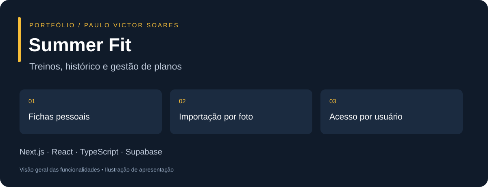

# Summer Fit



Aplicação web para organizar fichas de exercícios, registrar treinos e administrar planos de acesso. O projeto reúne interface responsiva, autenticação, persistência por usuário e integração de IA para leitura de fichas por foto.

**[Abrir aplicação](https://ios-web-view.vercel.app)** · [Código](https://github.com/paulovctxr/converter-app-para-ios-e-web)

> O endereço acima é o publicado no repositório. Os fluxos pessoais exigem conta; recursos administrativos exigem autorização. A imagem é uma visão geral ilustrada, não uma captura da interface.

## Tecnologias e decisões técnicas

| Camada | Implementação |
| --- | --- |
| Interface | Next.js, React, TypeScript e Tailwind CSS |
| Identidade e dados | Supabase Auth, PostgreSQL, migrações SQL e RLS |
| Integração de IA | Supabase Edge Functions; validação do resultado antes de salvar |
| Qualidade | TypeScript, Node Test Runner e PGlite |

## Como explorar

1. Abra a aplicação e use o cadastro/login disponibilizado na interface.
2. Crie uma ficha com exercícios, séries e repetições.
3. Registre uma sessão e consulte o histórico e a meta semanal.
4. Na importação por foto, revise o conteúdo extraído antes de salvar.

## Executar localmente

Pré-requisitos: Git, Node.js compatível com as versões de Next.js e pnpm do projeto, pnpm na versão indicada em `package.json`, e um projeto Supabase de desenvolvimento.

```sh
git clone https://github.com/paulovctxr/converter-app-para-ios-e-web.git
cd converter-app-para-ios-e-web
pnpm install --frozen-lockfile
cp .env.example .env.local
```

Preencha as variáveis de `.env.local` e siga a seção **Configuração obrigatória antes da publicação** abaixo para banco, autenticação e funções. Use um ambiente de desenvolvimento separado para experimentar.

```sh
pnpm dev
```

Abra o endereço exibido no terminal, normalmente `http://localhost:3000`. Os comandos de tipagem, testes e build estão documentados ao final.

## Organização do código

- `app/`: páginas, layout e rotas de autenticação.
- `components/`: interface de treinos, planos e administração.
- `lib/`: tipos, validações e integrações.
- `supabase/migrations/`: evolução do banco e permissões.
- `supabase/functions/`: integrações executadas no servidor.
- `tests/`: regras de domínio e acesso ao banco.

## Limites de escopo

Aplicação web para desktop e celular, com manifesto de instalação. Não equivale a uma publicação nativa na App Store. O funcionamento requer internet; o Mercado Pago pode confirmar o Summer PRO automaticamente e o PIX manual permanece como alternativa.

---

# Summer Fit / Summer Treinos — web e celular

Aplicativo Next.js com autenticação Supabase, fichas pessoais persistentes, registro de treinos e administração de planos. A integração GitHub/Vercel existente publica a branch `main`.

## Recursos

- Login, cadastro, recuperação de senha e mensagens de conexão em português.
- Fichas com exercícios, séries e repetições; edição, busca e exclusão.
- Importação de ficha por câmera ou galeria, com até quatro fotos, leitura por IA, alertas de baixa confiança e revisão obrigatória antes de salvar.
- Campos de carga, unidade, descanso e observações nos treinos importados e manuais.
- Demonstrações de 54 exercícios, com 108 fotos locais e associações revisadas a partir dos nomes usados nas fichas. Abreviações equivalentes recebem imagens automaticamente; códigos, protocolos e nomes de exercícios combinados são preservados, com uma demonstração para cada movimento reconhecido.
- Sessão de treino com cronômetro, checklist, histórico real e meta semanal. O andamento e o descanso são guardados no navegador por conta; recarregar, fechar a aba ou sair da conta preserva a sessão, e o tempo inclui o período fora do site. Concluir ou encerrar remove o andamento local. Outro aparelho/navegador não retoma esta sessão; limpar os dados do site também a remove. Se o armazenamento estiver indisponível, a interface avisa para manter a página aberta.
- Interface responsiva e manifesto para adicionar à tela inicial do celular. Internet é necessária; não há promessa de uso offline.
- `/admin`: painel exclusivo do proprietário, alunos paginados, pesquisa por nome/e-mail/matrícula disponível, filtros por situação e alertas de vencimento em sete dias.
- Summer Grátis (R$ 0): cadastro, treinos manuais, digitalização da ficha por foto, cargas, cronômetro e histórico básico.
- Summer PRO: promoção de lançamento de R$ 10,00 no primeiro mês; depois R$ 14,90/mês ou R$ 119,90/ano, com economia de R$ 58,90 no anual. Os preços ficam centralizados em `summer_private.plan_config`.
- O pagamento do Summer PRO pode abrir o Checkout Pro do Mercado Pago e liberar o acesso automaticamente após a aprovação. O fluxo manual via PIX permanece disponível como alternativa administrativa. O Summer PRO usa os status `free`, `pro`, `expired` e `cancelled`, com periodicidade mensal ou anual.
- A digitalização por foto permanece disponível no Summer Grátis. Para proteger o custo da IA, a cota mensal é configurável no painel e vale para todas as contas; repetir uma análise que falhou não é contado como conclusão.
- Espaço Summer PRO funcional: perfil nutricional, metas de calorias e macros, controle de água, cardápio personalizado de sete dias por IA e lista de compras automática.
- Evolução PRO com histórico completo, estatísticas, gráfico de cargas e recordes pessoais calculados a partir dos treinos concluídos.
- Biblioteca PRO com exercícios organizados por grupo muscular, busca, instruções de execução e cuidados práticos.
- O plano mensal aparece primeiro e já vem selecionado. O anual permanece disponível como alternativa com desconto.

## Configuração obrigatória antes da publicação

1. Configure `NEXT_PUBLIC_SUPABASE_URL` e `NEXT_PUBLIC_SUPABASE_ANON_KEY` (ou `NEXT_PUBLIC_SUPABASE_PUBLISHABLE_KEY`) no projeto Vercel e em `.env.local`. Use o mesmo projeto Supabase do login existente. Nunca coloque uma chave `service_role` no navegador.
2. Aplique, em ordem, todas as migrações de `supabase/migrations`. São alterações aditivas, mantêm as fichas existentes e protegem os dados por usuário.
3. O proprietário deve ter a conta **victorpaulognv@gmail.com** cadastrada e com o e-mail confirmado. Essa identidade foi confirmada pelo proprietário. A autorização usa a conta validada em `auth.users` e uma lista privada no banco, nunca campos editáveis do perfil.
4. Em Supabase Auth, autorize o endereço real do site e a URL `/auth/callback`, incluindo `/auth/callback?next=/auth/reset-password` para recuperação. Mantenha a confirmação de e-mail habilitada.
5. Depois de entrar, abra **Perfil → Administrar alunos e planos** ou `/admin`.
6. Cadastre a chave da IA somente nos segredos do Supabase e publique as Edge Functions. Nunca use essa chave em uma variável `NEXT_PUBLIC_*`:

```sh
supabase secrets set OPENAI_API_KEY=sua_chave
supabase functions deploy analyze-workout-sheet
supabase functions deploy generate-nutrition-plan
```

O segredo fica disponível imediatamente, sem novo deploy. A mesma `OPENAI_API_KEY` atende à digitalização e ao cardápio, portanto não é necessário cadastrá-la novamente. Opcionalmente, defina `WORKOUT_VISION_MODEL` ou `NUTRITION_TEXT_MODEL` para trocar os modelos sem atualizar o app. O padrão atual é `gpt-6-luna`. As funções exigem JWT válido, aplicam as cotas no banco e validam novamente todo resultado da IA.

A migração deve estar aplicada antes de disponibilizar esta versão a alunos. Sem ela, os dados não são inventados e operações falham de forma fechada. Os cadastros apresentados no painel são as contas desse projeto Supabase; uma matrícula ausente é exibida como “Não informada”. Não são importados automaticamente alunos de outro banco ou do APK antigo.

## Pagamentos: Mercado Pago e Pix

Para atualizar o banco existente do Summer, execute o arquivo [`docs/summer-pro-ativacao.sql`](docs/summer-pro-ativacao.sql) inteiro no SQL Editor do projeto `ntqcvzemkpmpnomdbnen`. Ele reúne as cinco novas migrações em uma transação (teste grátis, Mercado Pago, métricas, convites e depoimentos), preserva as fichas e solicita a atualização do cache da API. O arquivo é validado pelos testes em PostgreSQL local. A chave `service_role` usada pela API REST não permite instalar migrações; esta etapa requer SQL Editor ou acesso administrativo de migração. Aplique o script antes de disponibilizar o novo checkout aos alunos.

O teste é único por conta, dura sete dias pelo relógio do servidor e termina sem cobrança. Inclui uma geração de cardápio durante o período. A assinatura paga permanece separada do teste. Os convites `/convite/recepcao` e `/convite/avaliacao` têm QR Code; os depoimentos precisam ser cadastrados e publicados pelo administrador com autorização registrada. Nenhum depoimento é pré-preenchido.

O Checkout Pro usa o preço guardado em `summer_private.plan_config`; valores enviados pelo navegador são ignorados. O servidor cria uma preferência vinculada a um checkout interno. No webhook, consulta o pagamento diretamente na API do Mercado Pago, confere o identificador, o status aprovado, o valor exato e a moeda BRL, e só então libera ou estende a assinatura. Notificações repetidas são idempotentes. Os prazos são calculados no banco: um mês para o plano mensal e um ano para o anual.

Depois de aplicar `supabase/migrations/20261101090000_summer_mercado_pago.sql`, configure na Vercel as variáveis `NEXT_PUBLIC_SITE_URL`, `MERCADO_PAGO_ACCESS_TOKEN` e `SUPABASE_SERVICE_ROLE_KEY`. Cadastre a URL `https://SEU_DOMINIO/api/mercado-pago/webhook` na aplicação do Mercado Pago; se a plataforma fornecer uma assinatura secreta, salve-a como `MERCADO_PAGO_WEBHOOK_SECRET`. O token e a chave `service_role` são exclusivos do servidor e nunca podem receber o prefixo `NEXT_PUBLIC_`.

O endpoint autenticado `POST /api/mercado-pago/checkout` recebe `{"plan":"monthly"}` ou `{"plan":"annual"}` e devolve `{"checkoutUrl":"https://...mercadopago.com..."}`. O navegador redireciona para essa URL. O endpoint `POST /api/mercado-pago/webhook` é chamado pelo Mercado Pago e não deve ser usado pelo cliente. Se os segredos ainda não estiverem configurados, o checkout falha de forma fechada e o fluxo manual via Pix pode continuar sendo usado.

A chave Pix é a já fornecida pelo proprietário. Nesse fluxo alternativo, o administrador confere o pagamento antes de aprovar a solicitação. Cancelar encerra o acesso imediatamente, sem apagar o histórico. Nenhuma confirmação depende de preço ou status enviado pelo frontend.

Os dados sensíveis são protegidos por RLS e permissões SQL. Alunos só acessam seus próprios treinos e registros. Alterações de planos usam funções que verificam a administração no banco, com auditoria em `summer_private.plan_audit`. O acesso pago é verificado a cada consulta ao banco, mesmo que a interface ainda mostre um status antigo.

As imagens da ficha são reduzidas no aparelho, têm os metadados removidos pelo canvas e seguem diretamente para a Edge Function. Elas não são gravadas no Storage nem no banco. `summer_workout_imports` guarda apenas status, quantidade de imagens e o resultado estruturado. Tentativas que falham ou retornam uma ficha totalmente ilegível não consomem a cota.

## Desenvolvimento e validação

```sh
pnpm install --frozen-lockfile
pnpm dev
pnpm typecheck
pnpm test
pnpm build
```

Testes usam PostgreSQL local em memória (PGlite), sem dados de produção: bloqueio de administração para alunos/anônimos, isolamento entre contas, solicitação e aprovação via PIX, renovação, cancelamento, gravação concorrente, limites mensais de IA e proteção PRO no banco.

Limites atuais: 30 fichas por conta, 20 exercícios por ficha e os últimos 180 treinos concluídos. Fichas ficam em `summer_fitness_state`, fora do JWT de autenticação. A gravação detecta conflitos de revisão entre aparelhos. Esta alteração não recompila nem atualiza o APK Android existente.
